# Hi there, I'm Udeshika Balasooriya! 👋

<!-- Theme-sensitive animated banner -->
<picture>
  <source media="(prefers-color-scheme: dark)" srcset="dark.svg">
  <source media="(prefers-color-scheme: light)" srcset="light.svg">
  
</picture>

 

## 🚀 About Me
I'm a **final-year Software Engineering undergraduate at SLIIT** and a **Full Stack Developer** with Web and Android experience. I completed a **6-month Full Stack Developer internship at Thrimaa Interactive**, and I hold **Python** and **Web Design** certificates from **CODL, University of Moratuwa**.

My capstone, **VoiceBridge**, is an Android AAC platform for children with communication difficulties. Outside code, I've led as a school **Secretary** and **Primary Prefect**, and I work comfortably in both **Sinhala and English**.

> 💡 *I think I'm funny. My code sometimes agrees.*

- 🌐 **Web:** React, Node.js & Express, MERN-stack projects
- 📱 **Android:** Kotlin / Java apps, including my capstone
- 🌱 **Currently learning:** React, Node, Express, Android & SE best practices
- 🎓 **Education:** Software Engineering, SLIIT (final year)
- 💬 **Ask me about:** Web, Android
- ✉️ **Contact:** [piumiudeshika02@gmail.com](mailto:piumiudeshika02@gmail.com)

---

## 🛠️ Technical Skills

### 💻 Languages

### 🖥️ Frontend

### 📱 Mobile

### ⚙️ Backend

### 🗄️ Databases

### ☁️ DevOps & Tools

---

## 📂 Projects

| Project | What it is | Tech |
|---|---|---|
| 🗣️ **VoiceBridge** *(final-year capstone)* | Android AAC platform for children with communication difficulties | Android |
| 🍔 **FoodSprint** | Microservices-based food ordering app | MERN, Docker, Kubernetes |

<!-- TODO: add repo links, plus one-line descriptions for the projects below -->
**More:** RiceMart · AquaFlow · QuickNote · Salon Natural Bridal

---

## 📈 GitHub Stats & Metrics

  <picture>
    <source media="(prefers-color-scheme: dark)" srcset="https://activity-graph.vercel.app/graph?username=UdeshikaP&bg_color=030712&color=94A3B8&line=3B82F6&point=60A5FA&area_color=6366F1&area=true&hide_border=true&radius=12">
    <source media="(prefers-color-scheme: light)" srcset="https://activity-graph.vercel.app/graph?username=UdeshikaP&bg_color=FFFFFF&color=475569&line=2563EB&point=3B82F6&area_color=DBEAFE&area=true&hide_border=true&radius=12">
    
  </picture>

  <picture>
    <source media="(prefers-color-scheme: dark)" srcset="https://ghstats.dev/api/card?username=UdeshikaP&bg=030712&title_color=3B82F6&text=94A3B8&icon_color=60A5FA&border_color=6366F1">
    <source media="(prefers-color-scheme: light)" srcset="https://ghstats.dev/api/card?username=UdeshikaP&bg=FFFFFF&title_color=2563EB&text=475569&icon_color=3B82F6&border_color=E2E8F0">
    
  </picture>

  <picture>
    <source media="(prefers-color-scheme: dark)" srcset="https://ghstats.dev/api/langs?username=UdeshikaP&layout=grid&bg=030712&title_color=3B82F6&text=94A3B8&icon_color=60A5FA&border_color=6366F1">
    <source media="(prefers-color-scheme: light)" srcset="https://ghstats.dev/api/langs?username=UdeshikaP&layout=grid&bg=FFFFFF&title_color=2563EB&text=475569&icon_color=3B82F6&border_color=E2E8F0">
    
  </picture>

  <picture>
    <source media="(prefers-color-scheme: dark)" srcset="https://streak-stats.demolab.com?user=UdeshikaP&theme=dark&background=030712&stroke=6366F1&ring=3B82F6&fire=60A5FA&currStreakNum=3B82F6&currStreakLabel=94A3B8&sideNums=94A3B8&sideLabels=94A3B8&dates=6B7280">
    <source media="(prefers-color-scheme: light)" srcset="https://streak-stats.demolab.com?user=UdeshikaP&theme=light&background=FFFFFF&stroke=E2E8F0&ring=2563EB&fire=3B82F6&currStreakNum=2563EB&currStreakLabel=475569&sideNums=475569&sideLabels=475569&dates=94A3B8">
    
  </picture>

### 🐍 Contribution Snake

  <picture>
    <source media="(prefers-color-scheme: dark)" srcset="https://raw.githubusercontent.com/UdeshikaP/UdeshikaP/output/github-snake-dark.svg" />
    <source media="(prefers-color-scheme: light)" srcset="https://raw.githubusercontent.com/UdeshikaP/UdeshikaP/output/github-snake.svg" />
    
  </picture>

---

## 📫 Let's Connect

  
  
  

  

  by Udeshika Balasooriya

